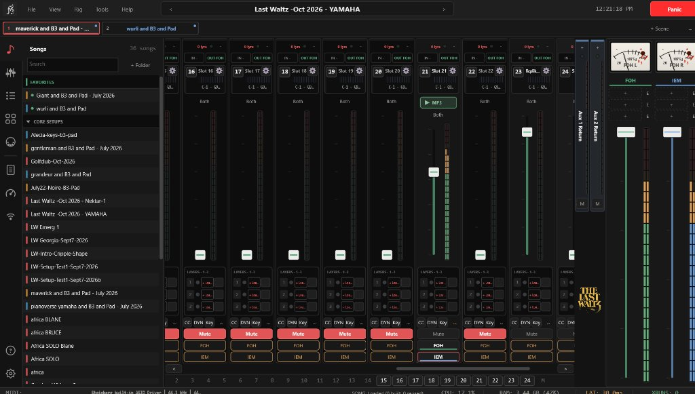
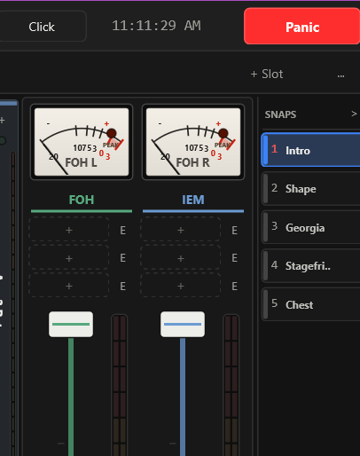
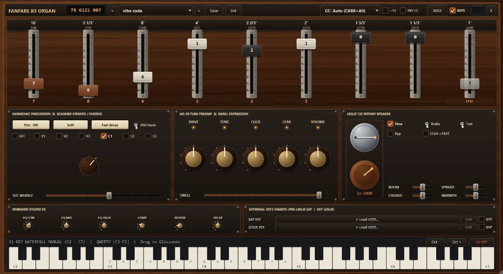
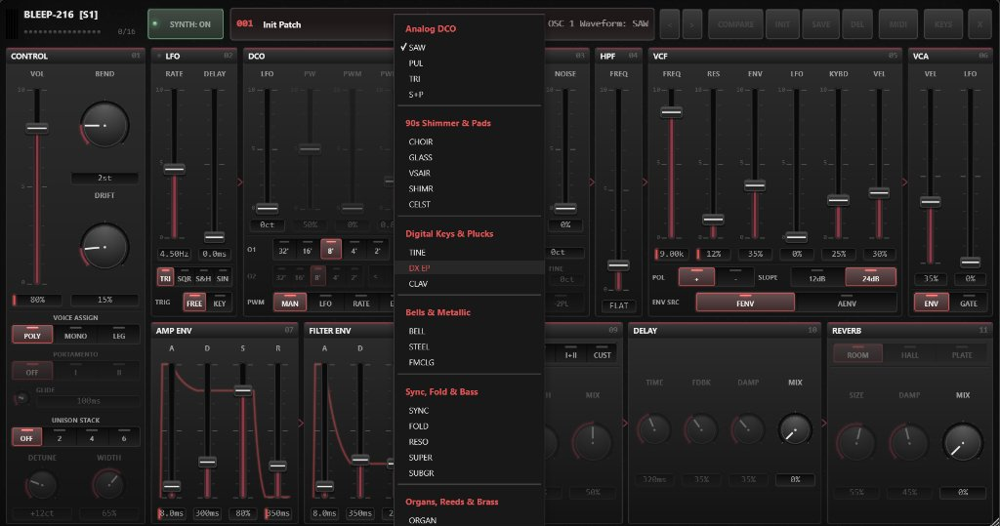
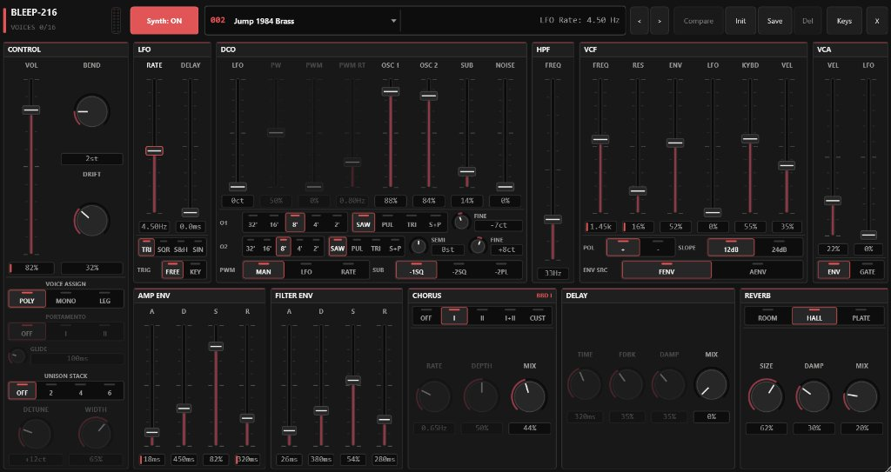
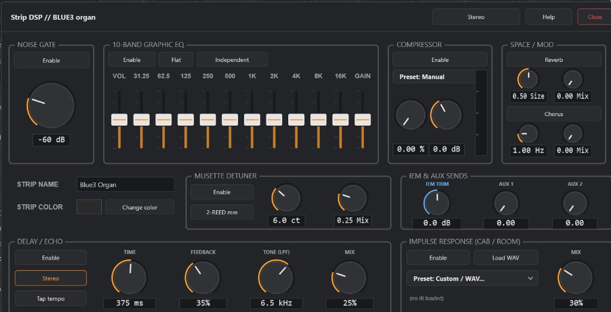

<div align="center">

# Fanfare

### A Windows VST3 host for live performance 

[](https://github.com/openrig-host/fanfare/releases/latest)
[](https://github.com/openrig-host/fanfare/releases)
[](https://www.gnu.org/licenses/gpl-3.0.html)

A rack-based Windows VST3 host and MIDI router for playing live. No dropouts, no stuck notes, no failed song changes.

[Download](#download) · [Getting Started](GETTING_STARTED.md) · [Features](#features) · [How It Works](#how-it-works) · [VST3 Plugins](#vst3-plugins) · [Make It Yours](#make-it-yours)

<br/>



</div>

> ### Made for the gig
>
> Fanfare runs your rig like a rack of hardware. Fixed channels, real-time audio threads that never wait on a lock, memory allocated up front, and song changes that either finish completely or don't happen at all.
>
> DAWs are for writing. This is for playing.

---

## What is Fanfare?

Fanfare is a Windows app that hosts VST3 instruments and effects in a fixed rack, the way hardware works. No virtual patch cables, no node graphs, no wires to drag around.

What it does on stage:

- **Splits, sample triggers, arpeggiators, octaves, and harmonizers.** Set them up once and forget about them.
- **Song changes load in the background.** The switch is atomic. If anything goes wrong, the current song keeps playing.
- **FOH and IEM are separate mixes.** Every slot sends to each one independently.
- **No stuck notes.** The panic button kills all MIDI within one audio block. Instrument swaps fade the old sound and release held notes cleanly.
- **Your mod wheel only hits the plugin you want.** Per-slot MIDI channel routing, CC remapping, and arm-then-wiggle CC learn.
- **Buttons can act like switches.** Any CC binding can latch, for parameters, mutes, or A/B swaps.
- **Hardware synths are welcome.** Any slot can send MIDI out to an external module instead of hosting a VST.
- **The next song is ready before you call it.** Setlists preload the next rig while you play.
- **Break music is handled.** A dual-deck player with playlists, BPM display, YouTube downloads, and cue trimming.

It's not a DAW. It's an instrument.

---

## Quick Start

1. **Install Fanfare.** Either install smoothly with no SmartScreen warning from the **[Microsoft Store](https://apps.microsoft.com/detail/9mw95413hg69?hl=en-US&gl=CA)**, or grab the latest unsigned `.exe` / `.msi` from **[GitHub Releases](https://github.com/openrig-host/fanfare/releases/latest)** (usually more current, as Microsoft certification takes a few days).
2. **Set up audio and MIDI.** From the Startup Welcome screen or **`Rig → Audio & MIDI settings...`**, pick your **ASIO** driver (or WASAPI) and enable your MIDI controller.
3. **Load a song or fill a slot.** Pick a recent song on the Welcome screen, double-click a song in the left **Songs** sidebar, or click **`+`** on any channel strip slot to load a VST3.
4. **Set key ranges and MIDI mappings.** Open the strip **`...`** menu for **Note range & transpose**, or click **`CC`** to open the CC Assignment Manager and apply your global **Controller Profile**.

> The full walkthrough is in **[GETTING_STARTED.md](GETTING_STARTED.md)** and the 26-chapter **[Stage Survival Manual](https://openrig-host.github.io/fanfare/manual.html)**.

---

## What's New in v1.73: Snapshots Rail, Permanent Setlist Bar & B3 Upgrades

<p align="center">
  
</p>

- **Far-Right Vertical Snapshots Rail (`SNAPS`).** A stationary, collapsible vertical rail anchored to the far-right edge (84 px expanded / 22 px collapsed) that switches strip mutes, FOH/IEM volumes, key ranges, transpose, strip DSP, and CC/MIDI overrides in **0 ms** with zero VST reloads. Color-taggable (9 stage colors), explicit `+` capture and `UPD` save (never accidentally overwrites on click), `1`–`9` hotkeys, MIDI Program Change learn, and glitchless recall that lets held notes ring out when pitch/range didn't change.
- **Permanent Auto-Preloading Top Setlist Bar.** Decoupled from internal Snapshots so clicking a song never alters the bar; syncs directly with `SetlistManager` to preload the next song automatically with amber (loading) and green (ready) LED indicators.
- **Fanfare B3 Organ Upgrades.** Embedded real walnut wood-grain console texture, retuned 10-band studio voicing curve (warmer 31–125 Hz bottom end + extra 4–16 kHz high-drawbar shine), zero-cancellation Leslie `SPREAD` narrowing, and creamier Slow Leslie wall-reflection swirl.
- **Stage Survival Utilities.** One-click **`Reset Audio`** button in the bottom status bar (with 80 ms USB ASIO settle), **IEM-only Click Track / Count-In** (`Click` in top bar, never sent to FOH), and global **Backup Keyboard Input Remap** (`Rig → Backup Keyboard Map...`).

---

## What's New in v1.7: Tonewheel & Wavetable Edition





- **Fanfare B3 Built-In 91-Tonewheel Organ & Dual Leslie 122 (`v1.7`).** Every channel strip slot can now host a full native Hammond B3 & Dual Leslie 122 simulation housed in a vintage walnut and brushed-bronze hardware console — synchronous tonewheel gear ratios with magnetic reluctance waveform shaping and 12-bin shaft micro-flutter, 9-busbar palladium contact stagger key-click, generator crosstalk (`LEAK`), single-trigger post-scanner Harmonic Percussion, 8-stage LC Scanner Vibrato/Chorus with inductor saturation, 4x-oversampled AO-28 tube preamp with 120 Hz B+ ripple, Dual Asynchronous Leslie 122 with mono-to-stereo `SPREAD` (mono rotor swish + stereo room), `WARMTH`, `CHORUS`, and `ROOM`, Studio Wood Room convolution IR + 10-band voicing, 301 ms Ping-Pong `DELAY`, external `SAT VST` / `LESLIE VST` insert slots (with automatic Mod Wheel forwarding), custom named Drawbar CC Learn (`+ Learn / Edit Drawbar Map...`), `+12` octave transpose, toggleable 61-key waterfall manual (OFF by default), and the **`vibe coda`** default preset (`C1`, `0.28` warble).
- **BLEEP-216 20-Bank 64-Frame Wavetable Engine (`96 Presets`).** `OSC 1` and `OSC 2` in **BLEEP-216** now include **20 mipmapped 64-frame wavetable banks** (`CHOIR`, `GLASS`, `VSAIR`, `SHIMR`, `CELST`, `TINE`, `DX EP`, `CLAV`, `BELL`, `STEEL`, `FMCLG`, `SYNC`, `FOLD`, `RESO`, `SUPER`, `SUBGR`, `ORGAN`, `REED`, `FLUTE`, `BRASS`) with 7 Nyquist-safe mip levels, `PWM / SHAPE` wavetable morphing via `MAN`, `LFO`, `RATE`, or `ENV`, and **11 new Wavetable & Hybrid presets** (96 presets total).
- **Web Remote Live Plugin Mirror & macOS Build Prep.** Added an experimental bidirectional touch-enabled Live Plugin Mirror prototype in the Web Remote HUD, plus cross-platform Clang/macOS build preparation.
- **Recent Bugfixes & Strip UX Polish (v1.61–v1.7):**
  - **Live Rack IEM Fader Fix:** `sumToIemBus` now multiplies `iemLevel * iemOffset` so the rack IEM fader controls base level while DYN `IEM TRIM` acts as relative trim, with MIDI-CC learn writing `iemLevel` cleanly.
  - **Song JSON `extra` Preservation & Atomic Setlist Saves:** Unknown/newer top-level Song JSON fields survive save/load round-trips (`Song::extra`), and `SetlistManager::saveSetlist` now writes atomically via `.tmp` + `moveFileTo`.
  - **Live MIDI Status Readout & `KEY` Strip Action:** Top status bar shows live decoded MIDI events (while song load messages show in the preload status area), `KEY` moved to the Studio strip button row with amber active indicators, and Transpose (`-48..+48` st) is integrated directly into the Note Range dialog.
  - **Security, Stability & UI Fixes:** `yt-dlp` invocations hardened with `--` end-of-options separator, `fm` finished envelopes snap cleanly to zero without denormal grinding, dark-on-light library badge contrast fixed, 1 px keyboard focus ring added to Studio buttons, and passive `LAYER`/`8-WAVE` tags restyled cleanly in CoplanDX.

---

## Previous Highlights in v1.60: The 1984 Keyboard Rig Edition

**(A superpowered Juno-106 + DX7, but better, native and onboard)**



- **CoplanDX Built-In Multi-Engine FM Synthesizer (`v1.60`).** Every channel strip slot can now host **CoplanDX** (`DX`) — a native 16-voice Yamaha FM synthesizer running five selectable hardware topologies: **DX7** (6-operator, 32 algorithms), **DX21 / DX100** (4-operator, 8 algorithms), **TX81Z** (4-operator, 13 algorithms, 8 multi-waveforms `W1`–`W8`), **DUAL 2x4 OP** (layered 4-op voices), and **DUAL 2x6 OP** (layered 6-op voices). Powered by Google's `msfa` phase-modulation kernel and paired with an onboard BBD Chorus, Stereo Delay, and 3-mode **LushReverb** (`ROOM`, `HALL`, `PLATE`) tank.
- **558 Categorized Vintage FM Presets + `.syx` Archive (`Source/Synth/Fm/FmPresetLibrary.inc` & `fm-sysex/`).** Ships with **558 authentic factory voices** extracted and converted from classic **DX7** (`ROM1A`–`ROM4B`), **DX100**, and **TX81Z** ROMs, sorted into 11 musical categories (*Piano & Keys*, *Organs*, *Bells & Mallets*, *Strings & Pads*, *Brass & Winds*, *Synth Leads*, *Bass*, *Guitars & Plucks*, *Voices & Choir*, *Drums & Percussion*, *SFX & Atmospheres*) with `[DX7]`, `[DX100]`, and `[TX81Z]` provenance badges, category-tailored Chorus/Delay/Reverb FX, user `.json` preset saving (`fm-presets/`), and direct `.syx` 32-voice bulk dump import.
- **BLEEP-216 Built-In 16-Voice Analog Polysynth (`68 Presets`).** A native, zero-dependency Juno/Jupiter-inspired polyphonic synthesizer (`SYN`) with dual band-limited PolyBLEP DCOs (`32'`–`2'`, Saw/Pulse/Tri/Saw+Pulse, Osc 2 semitone + fine detune, Manual/LFO/Rate PWM), dedicated Sub-Oscillator and Noise generator, pre-filter HPF, 12/24 dB Cytomic SVF resonant low-pass filter, dual ADSR envelopes, `POLY`/`MONO`/`LEG` voice modes, Portamento (`I`/`II`), up to **6-voice Stereo Unison Stack**, per-voice analog `DRIFT`, bucket-brigade **Chorus** (`I`, `II`, `I+II`, `CUST`), stereo **Delay**, and **LushReverb**.
- **3-Slot Multi-Synth Chain Stacking & 11 Hybrid "1984 Rig" Strips (`strips/`).** Each channel strip's 3 instrument slots (`1`, `2`, `3`) can independently host **BLEEP-216** (`SYN`), **CoplanDX** (`DX`), VST3 plugins, or external MIDI-OUT destinations — each with its own **Note Range** split (`Low`–`High`), **Level**, and **Bypass**. Includes **11 ready-to-play dual-engine `.orstrip` presets** (*01 FM Bell & Flute Pad* through *10 Space Chime & Nostalgia Flute*, plus *flute+fmxylo*) that pair crystalline FM mallets, vibes, chimes, and tubular bells with warm analog Juno flute and PWM pads on a single strip.
- **Fanfare Developer Blog (`docs/blog/`).** New gig-tested engineering blog covering 1980s multi-keyboard hardware rigs, Sunday post-gig dev sprints, accordion wireless routing, and building native synthesizers in under 15 MB.

---

## Previous Highlights (v1.52 – v1.55)

- **Rig Doctor: Setup Diagnostics & Surgical Repair (`v1.52`).** Open **`Tools → Rig doctor...`** (or right-click any song in the **Songs** sidebar → **`Diagnose & repair (Rig Doctor)...`**, or run **`tools/rig_doctor.ps1`** from PowerShell) to rehabilitate any setup `.json` that stops loading. Rig Doctor runs static schema/Base64/media validation, diffs every slot against its `.bak` backup to spotlight recent plugin or patch edits, scans `OpenRig_log.txt` for historical stalls, dry-runs every VST3 in isolation (`TEST ALL PLUGINS`) with millisecond timing and `PATCH FAULT` vs `STALLED` classification, and lets you surgically **`KEEP`**, **`OFF`** (disable), **`RESET`** (clear corrupt patch state), or **`REMOVE`** individual plugins while preserving 100% of your mixer faders, splits, CC maps, and scenes.
- **Deadlock-Free Two-Phase VST3 Loader & Segmented `[X/N]` Progress (`v1.52`).** Song transitions now run a non-overlapping two-phase build — sequential STA message-thread initialization for QML/UI-bound instruments (Native Instruments Komplete/Kontakt/Raum/Massive family, Spectrasonics, Toontrack, HALion) followed by parallel MTA worker builds — eliminating Win32/COM loader lock contention on complex multi-synth songs, paired with a discrete **`N`-segment LED progress bar** (`[X/N]`) and non-blocking **`Cancel`**.
- **Stage Ergonomics: Next-Up Capsule, `1–9` Scene Hotkeys & Live Status Bar (`v1.52`).** A clickable **`Next-Up`** preload capsule in the top bar mirrors background setlist readiness and fires the next song in one click; number keys **`1`–`9`** recall scenes directly (with a **`+N`** overflow menu on wide scene banks); and the bottom telemetry bar now displays your live audio device, sample rate, and buffer size alongside clickable, color-thresholded `CPU` (>70% amber / >90% red), `RAM`, `LAT`, and `XRUNS` segments.
- **Embedded 100% Offline Help Manual & MP3 Strip Indicator (`v1.51`).** All `Help` buttons work standalone from any directory (even a single `Fanfare.exe` on your Desktop with zero internet or companion folders) via built-in embedded assets, channel strips with loaded MP3 playlists display a dedicated clickable **`MP3`** badge button (never disguised as empty), and the Web Remote API, lock-free MIDI learn routing, and scene serialization are hardened end-to-end.

- **Studio Default Theme, Scarlett & 5 Studio Palettes (`View → Theme`).** Ultra-clean flat charcoal workspace with embedded **Source Sans 3** UI typography and crisp **JetBrains Mono** numeric readouts across five flat Studio themes — **`Studio`** (warm `#FFA02F` amber default), **`Studio Scarlett`** (synth-editor black + crimson red), **`Studio Sapphire`** (midnight slate + ice blue), **`Studio Jade`** (dark graphite + phosphor mint), and **`Studio Daylight`** (flat light paper) — plus classic **`Front Panel Dark`** and outdoor **`Front Panel Bright`**.
- **Vertical Ribbon Sidebar & Top Menu Bar.** A 40px icon rail switches the left drawer cleanly between **Songs**, **Strips**, **Setlist**, **Queue** (10 instant stage tiles), and a live **MIDI Monitor**, paired with a slim `File · View · Rig · Tools · Help` menu bar, centered `< Song Name >` switcher pill, live stage clock, and bottom monospace telemetry footer.
- **Startup Splash & Welcome Screen.** Bespoke stage-spotlight splash screen with live startup progress bar, followed by a toggleable **Welcome Screen** (`Show on startup`) featuring Recent Songs, `New song`, `Open song...`, `Build from strips...`, and one-click `Scan VST3 plug-ins...`.
- **Decluttered Stage Strips (`CC · DYN · ...`).** Preset saving/loading, note-range splits, MIDI FX, 8-pad sampler, MP3 deck, strip rename, and strip colors live cleanly inside the **`...`** menu (or right-click) so stray stage clicks never pop file dialogs beside live faders.
- **Global Controller Profiles (`Rig → Controller profile...`).** Define your physical keyboard's CCs *once* (saved in `%APPDATA%/Fanfare/controller_profile.json`, pre-seeded with Yamaha CK88 defaults) and apply them inside any strip's CC Manager with one click on **`Profile`**.
- **Timestamped Save Version History.** Every Song, Setlist, and Strip save records rotating snapshots in `%APPDATA%/Fanfare/history/`; right-click any item in the Library Sidebar and choose **`Version history...`** to inspect and restore prior versions in one click.

---

## Features

### The Rack
- **24 fixed slots.** One instrument per slot, always in the same order.
- **FOH, IEM, and direct outs.** Separate FOH (1-2) and IEM (3-4) levels, mutes, and enables on every slot, plus direct hardware outputs (5, 6, 7, 8) for things like a vocal mic or a dry send.
- **Input channel modes.** Switch any slot between Stereo, Mono (L+R), Mono (Left), and Mono (Right).
- **Per-slot MIDI routing.** A global default, overridable per slot.
- **Instrument stacking.** Several instances of the same plugin in one slot, each with its own level, note range, and on/off.
- **Dark UI.** Hardware-style controls and no cable clutter.

### Songs, Scenes, and Setlists
- **Songs (Rigs).** Full patches saved as versioned JSON.
- **Scenes.** Verse, chorus, and bridge variations you can recall by hand or by MIDI.
- **Setlists.** Ordered song lists with one-click load and automatic preload of the next song.
- **Atomic transitions.** New rigs are built and checked off-thread, then swapped in all at once.
- **Automatic rollback.** If a load fails, the current rig keeps playing.
- **Clean-slate mode.** Fully unload the old rig before loading a heavy one.

### MIDI
- **Arm-then-wiggle CC learn.** Click Learn, move a control, done.
- **Latch mode (TOG).** Turn any binding into a toggle.
- **Mute toggles.** Bind strip mutes to a CC.
- **Instrument swap.** Flip between two loaded instruments without unloading either.
- **Long-press learn.** Hold MUTE, FOH, or IEM to start learning that control.
- **Scene triggers.** Assign a Program Change and channel to any scene.
- **MIDI monitor.** See exactly what your controller is sending.
- **MIDI out slots.** Send filtered MIDI to hardware instead of a plugin.

### DSP and Effects


- **Channel strip on every slot.** Noise gate, 10-band Graphic EQ with **Independent** and **Curve-Link** (proportional neighbor contour) modes, compressor with live gain-reduction meter, stereo/ping-pong/mono/tape delay with Tap Tempo, chorus, reverb, per-strip **IEM Trim**, and convolution IR loader with **6 built-in synthesized acoustic spaces & tube cab** (plus custom `.wav` loading).
- **Musette detuner.** Accordion-style MM (2-reed) and MMM (3-reed) detuning that keeps the attack dry, plus **"TEMU Musette"**, a deliberately cheap, wildly out-of-tune setting for when the song needs it.
- **Direct hardware outs.** Send a slot straight to an interface output (for example, Out 5 on a UMC1820) while keeping its FOH and IEM sends independent.
- **Sampler with waveform editor.** Load a WAV and trim it to the sample.
- **Arpeggiator.** Up, Down, Up-Down, and Random, locked to BPM.
- **Octave harmonizer.** Add sub and upper octaves.
- **MIDI effects.** Transposer and more, per slot.
- **Master FX.** Reverb, EQ, and compression on the main buses.

### Between Sets
- **Dual-deck in-RAM break music player.** Six instant playlist banks, automatic BPM & downbeat detection, non-destructive In/Out cue trimming, Auto-DJ & Beat-Sync crossfades (`Vinyl Clean` or `Key-Lock`), Smart BPM Arrange, and a built-in **Broadcast Auto-Leveler (`LEVEL: ON`)** with live gain-reduction metering so track volumes stay consistent across your break set.
- **YouTube grab.** Paste a link and a 192 kbps MP3 lands right in your playlist.
- **Music library.** Built-in SQLite database with CSV, JSON, Extended M3U (with cue points), and `.db` snapshot export.
- **Gig notepad.** Notes for each show, right next to the rig.
- **Web remote.** Control it from a phone or tablet on the same network.

### Reliability
- **Panic button.** All Notes Off to every plugin in the next audio block.
- **Parallel loading.** Plugins load at the same time, with safe handling for plugins that need it.
- **Safe saves.** Files are written atomically and backed up automatically.
- **Crash containment.** A misbehaving VST3 doesn't take down the show.
- **Stage-proof USB hotplug & ASIO auto-recovery (New in v1.3).** When your bass player accidentally yanks your USB cable out of the computer, just put it back in, count to three, go back to playing, and smile at your bass player. Possibly the single most important update in Fanfare history!
- **Per-plugin isolation & Rig Doctor rehabilitation.** One plugin failing or timing out doesn't stop the audio — and if a third-party VST3 update or corrupt patch state ever makes a saved song stall, **Rig Doctor** (`Tools → Rig doctor...` or `tools/rig_doctor.ps1`) pinpoints the offending slot and rehabilitates the `.json` setup in place without losing your scenes or routing.
- **Rig migration.** Older rig files upgrade automatically. Files from newer versions are refused instead of half-loaded.

### Engine, CPU & USB Hotplug Reliability (New in v1.2 & v1.3)
- **Live USB Hotplug & Automatic ASIO Recovery (v1.3).** When your bass player accidentally yanks your USB cable out of the computer, just put it back in, count to three, go back to playing, and smile at your bass player. Possibly the single most important update in Fanfare history! Fanfare detects disconnected or stalled ASIO interfaces and unplugged USB MIDI controllers, immediately sends All Notes Off so nothing hangs, protects `audio_settings.xml` from falling back to laptop speakers, and automatically reconnects your ASIO driver and MIDI inputs as soon as the USB cable is plugged back in.
- **Lock-free Parallel Work-Sharing DSP.** Persistent real-time DSP helper threads share active instrument slots with the ASIO audio thread itself using lock-free atomics. There are no mutexes, no heap allocations on the audio thread, and no `ThreadPool` dropped-job stalls. Active worker count scales automatically to one worker per physical Performance core.
- **Hybrid CPU Core Split (P-Cores for Audio, E-Cores for Everything Else).** On Intel 12th Gen and newer hybrid laptops, real-time ASIO and DSP threads are pinned exclusively to fast Performance cores while the UI, graphics rendering, plugin disk streaming, and background setlist preloading run on Efficiency cores. Preloading the next song never steals cycles from live audio.
- **CPU Core 0 Interrupt Shielding.** Keeps real-time audio off Core 0, where Windows and laptop firmware dump Wi-Fi, USB hub, ACPI, and battery-polling driver interrupts (DPCs).
- **Clean Priority Tiering Without MMCSS Storms.** Runs the host in `Above Normal` priority class (and automatically restores it if an ASIO driver elevates the process) so internal plugin background threads stay safely below Priority-15 DSP helpers and Priority-24 ASIO without triggering Windows MMCSS 80% CPU throttling.
- **In-App Engine & CPU Tuning Panel.** Open `Settings` and click `ENGINE & CPU TUNING` for plain-English controls covering Hybrid P-Core pinning, Core 0 shielding, Windows 11 EcoQoS blocking, Parallel vs. Sequential processing, and an AC power stage advisory so players on Intel Hybrid, AMD Ryzen, or older CPUs can dial in their machine.
- **One-Click XRUNS Telemetry, Thermal Guard & Milestone Update Check (v1.41).** False-positive counter spikes during audio driver startup and active song swaps are suppressed; click `XRUNS:` in the top bar anytime to zero the counter and inspect `audio_underrun_log.txt`. A background **CPU Thermal & Firmware Throttle Monitor** alerts you if stage heat or power caps clamp clock speeds, and a quiet one-shot **GitHub Milestone Update Checker** notifies you in the header only on major/minor releases (e.g. `v1.5` or `v2.0`) while failing silently offline.

### Where your data lives
Everything is under `%APPDATA%/Fanfare/`:

| Folder | Contents |
|---|---|
| `songs/` | Rig files (`.json`) |
| `sets/` | Setlists |
| `strips/` | Reusable channel strip bricks (`.orstrip`) |
| `history/` & `backups/` | Timestamped version history snapshots & rotating `.bak` copies |
| `settings/` | Preferences, audio setup, and global `controller_profile.json` |

The `.exe` is self-contained. Icons are built in, so there are no extra files to keep track of.

---

## How It Works

```
                       Keyboard
                                │ MIDI
                                ▼
        ┌──────────────────────────────────────┐
        │            Fanfare Engine            │
        │   ┌─────┬─────┬─────┬─────┬─────┐   │
        │   │ S0  │ S1  │ S2  │ S3  │ ... │   │  ← Linear rack
        │   │ Mon │Kbd  │Organ│VSTi │Aux  │   │     (no cables)
        │   └─────┴─────┴─────┴─────┴─────┘   │
        │         │ FOH       │ IEM            │  ← Dual bus
        │         ▼           ▼                │
        │   Master FOH    Master IEM           │
        │     FX bus        FX bus             │
        └──────┬──────────────┬────────────────┘
               │              │
               ▼              ▼
           FOH Out        IEM Out
```

**What happens when you change songs:**

1. `SetlistManager` calls `RigTransitioner::transitionToFile(nextSong)`.
2. `RigBuilder` loads the new rig's plugins in parallel on worker threads.
3. Each new plugin is tested with a silent `processBlock`.
4. The transitioner takes the lock, swaps pointers, and lets go.
5. The old rig unloads. The new one is live.
6. If anything failed along the way, the swap never happens and the current rig keeps playing.

---

## VST3 Plugins

Fanfare handles the quirks of the big plugin makers for you: Native Instruments and Roland plugins restore on the GUI thread, plugins that throw during load are caught and skipped, and plugins that hang are timed out. These are in the built-in plugin list and are used on stage:

| Plugin | Vendor | Type |
|---|---|---|
| **Hammond B-3X** | Hammond / SkyLabs | Tonewheel organ, with split and pedal note-range filters |
| **Kontakt 8** | Native Instruments | Sampler |
| **Super 8** | Native Instruments | Polysynth |
| **Supercharger GT** | Native Instruments | Tube compressor |
| **Omnisphere** | Spectrasonics | Synth |
| **UVI Workstation** | UVI | Sampler |
| **Syntronik 2** | IK Multimedia | Vintage synth collection |
| **JUNO-106** | Roland Cloud | Polysynth |
| **ZENOLOGY** | Roland Cloud | ZEN-Core synth |
| **XV-5080** | Roland Cloud | PCM rompler |
| **Jun-6 V** | Arturia | Polysynth |
| **Replika XT** | Native Instruments | Delay |
| **Chorus JUN-6** | Arturia | Chorus |
| **Pre 1973** | Arturia | Preamp |
| **Pre TridA** | Arturia | Preamp |
| **Bus EXCITER-104** | Arturia | Exciter |
| **Bus FORCE** | Arturia | Bus processor |
| **Bus PEAK** | Arturia | Limiter |
| **MixBox** | IK Multimedia | Channel strip and multi-FX |
| **Blue3 Organ** | Cherry Audio | Tonewheel organ |
| **PolyMax** | Universal Audio | Polysynth |
| **bx_meter (VU)** | Brainworx | Metering |
| **bx_console Focusrite SC** | Brainworx | Channel strip |
| **TR5 Metering** | IK Multimedia | Metering |
| **TR5 British Channel** | IK Multimedia | Channel strip |
| **TR5 White Channel** | IK Multimedia | Channel strip |
| **EZkeys 2** | Toontrack | Pianos |

### Hardware

Used on stage with:

- **MIDI controllers:** Yamaha CK88, Roland RD-88, Nektar LX61+, Arturia KeyLab 88 Essential. Any class-compliant USB MIDI keyboard works.
- **Audio interfaces (ASIO):** Yamaha Steinberg USB ASIO (CK88), Behringer UMC1820, Behringer UMC204HD, AKAI EIE Pro. Any interface with an ASIO driver works.

---

## Download

You have two ways to install Fanfare on Windows 10/11 (64-bit) with **ASIO support**:

- **Microsoft Store (Signed — No SmartScreen Warnings):** [**Get Fanfare Live on Microsoft Store**](https://apps.microsoft.com/detail/9mw95413hg69?hl=en-US&gl=CA)
  Installs smoothly with zero security warnings. Updates take a few days to clear Microsoft Store certification.
- **GitHub Releases (Most Current — Unsigned):** [**Download Latest from GitHub Releases**](https://github.com/openrig-host/fanfare/releases/latest)
  Always has the newest fixes and features first (`Fanfare.exe`, `.msi`, and portable `.zip`), **but is unsigned** and will trigger a Windows SmartScreen warning on installation (*More info → Run anyway*).

> Releases are built with ASIO enabled and uploaded to GitHub directly. There's no CI build because Steinberg's ASIO SDK license doesn't allow it to live in a public repo or on a public build server.

### Requirements
- Windows 10 or 11 (64-bit)
- An audio interface or sound card
- An **ASIO driver** for your interface (recommended for live use). Without one, Fanfare uses WASAPI.

### Building it yourself

> **ASIO SDK licensing:** The Steinberg ASIO SDK can't be included in this repo. To build with ASIO, download the SDK from the [Steinberg Developer Portal](https://www.steinberg.net/developers/) and put the headers here:
> ```
> C:\JUCE\modules\juce_audio_devices\native\asio\
> ```
> It has to be that exact path, because that's where the project's `AppConfig.h` looks for it.

You'll need:
1. **Visual Studio 2022 or later** with the "Desktop development with C++" workload
2. **[JUCE 8](https://juce.com)** installed at `C:\JUCE`
3. **Steinberg ASIO SDK**, placed as described above

Open `Fanfare.jucer` in the Projucer (it comes with JUCE) and save it to generate `Builds\VisualStudio2026\Fanfare.sln`. Open that solution, set **Release / x64**, and build. You'll get `Fanfare.exe`.

For the CMake build, command-line MSBuild, and troubleshooting, see **[BUILDING.md](BUILDING.md)**.

---

## Make It Yours

**All the source is here. Fork it, change it, ship your own version.**

Fanfare was built with AI coding tools: [Antigravity](https://antigravity.dev) and KiloCode, using Gemini, Claude, Minimax, Zai, and Xiaomi models. You can keep going the same way.

1. **Get the source.** Use the green "Code" button and "Download ZIP", or `git clone`.
2. **Unzip it.**
3. **Open the folder in Antigravity**, or any AI coding agent that can work with C++ and JUCE.
4. **Ask for what you want.** For example:
   - *"Add a new VST to the plugin registry in FanfareEngine.h."*
   - *"Add VST2 hosting alongside VST3."*
   - *"Add a transpose knob to the channel strip."*
   - *"Port this to JUCE 9 when it comes out."*
   - *"Add support for my controller."*
5. **Keep going.** The agent sees the whole codebase, so it can make real changes.

You'll need the build setup from [BUILDING.md](BUILDING.md): Visual Studio, JUCE, and the ASIO SDK if you want ASIO.

**Pull requests are welcome but not required.** If you distribute a modified version, though, the [GPL v3](LICENSE) requires you to publish your source.

---

## Philosophy

1. **Predictable beats flexible.** Slots are fixed. Routing is fixed. The same key makes the same sound every time.
2. **When something fails, nothing changes.** A failed song switch leaves the current rig playing. A crashed plugin leaves the other slots playing. The panic button works in the next audio block.
3. **Heavy lifting happens in the background.** Loading, preloading, and saving stay off the audio thread and out of your way.
4. **Your files are yours.** Rigs are JSON. Backups are automatic. No cloud, no account, no telemetry. Your setlist is a folder you can open, edit, and back up however you like.

---

## Roadmap

- [x] **Themes.** Five to choose from, including a light theme
- [x] **Parallel plugin loading**, with GUI-thread restore for NI plugins
- [x] **CC latch and toggle, mute toggles, long-press learn, instrument swap**
- [ ] **HiDPI layout** for high-resolution stage screens
- [ ] **Out-of-process plugin hosting**, so each plugin runs in its own process
- [ ] **Touch mode** for a tablet as a second screen

---

## License

**Fanfare is licensed under the [GNU General Public License v3.0](LICENSE).**

GPL v3 was picked on purpose. Steinberg offers the ASIO SDK under GPL v3 as an alternative to its proprietary license, so licensing Fanfare the same way keeps the ASIO builds legal to share.

In practice:
- You can use, study, change, and share Fanfare, including the ASIO builds.
- If you **distribute** a modified version, as a binary or as source, you have to release your changes under GPL v3 too.
- The ASIO SDK itself still can't be included in this repo. Download it yourself as described in [BUILDING.md](BUILDING.md).

## Credits

Built with [JUCE 8](https://juce.com).

Made with [Antigravity](https://antigravity.dev) and KiloCode, using [Gemini](https://deepmind.google/technologies/gemini/), [Claude](https://anthropic.com), Minimax, Zai, and Xiaomi.
